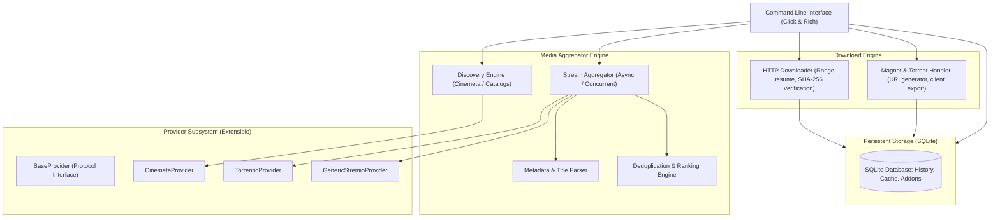

# Media Source Aggregator

An independent, extensible Python media aggregator inspired by Torrentio and the Stremio ecosystem.

---

## 🌟 Key Features

- **Protocol Agnostic**: Reverse-engineers and implements the official Stremio Add-on Protocol (v1–v3) for metadata, catalogs, and streaming resolution.
- **Concurrent Aggregation**: Concurrently queries multiple configured add-on providers (e.g., Torrentio, Cinemeta, Anime Kitsu, MediaFusion) using thread-pool concurrency.
- **Intelligent Deduplication**: Automatically detects and merges duplicate streams by `infoHash`, direct URL, or matching release titles, combining trackers and retaining maximum reported peer seeds.
- **Rich Stream Parsing**: Extracts and organizes resolutions (`4K`, `1080p`, `720p`, `480p`, `CAM/SCR`), HDR standards (`Dolby Vision`, `HDR10+`, `HDR10`, `10-bit`), audio codecs (`Dolby Atmos`, `TrueHD`, `DTS-HD MA`, `DD+ 5.1`, `7.1`), file sizes, seed counts, and indexer source tags.
- **Resilient Downloader Engine**:
  - **HTTP/HTTPS**: Chunked streaming downloader with byte-range resume (`Range: bytes=X-`), speed tracking, ETA calculation, and SHA-256 verification.
  - **BitTorrent / Magnet**: RFC-compliant Magnet URI construction with high-speed public tracker pools, BEP-53 selective file indices (`so=X`), `.magnet` file export, and local client dispatch (`aria2c`, `transmission-remote`, `qbittorrent`, `xdg-open`).
- **Persistent Local Records**: Embedded SQLite database (`~/.media_aggregator/data.db`) storing media metadata cache, discovered stream history, download history, and provider configurations.
- **Interactive CLI & Rich Formatting**: Terminal interface built with Click and Rich, displaying colored tables, details panels, and progress bars.

---

## 🏗️ Architecture



---

## 🔍 Reverse-Engineering Torrentio & Stremio

### 1. Stremio Add-on Protocol
Stremio add-ons expose a RESTful JSON API:
- `manifest.json`: Defines add-on metadata, supported resource types (`catalog`, `meta`, `stream`), and ID prefixes (`tt` for IMDb).
- `/catalog/{type}/{id}.json`: Catalog discovery (e.g. top movies or series).
- `/catalog/{type}/{id}/search={query}.json`: Keyword search.
- `/meta/{type}/{id}.json`: Full media synopsis, cast, genres, and series episode breakdown (`season`, `episode`, `released`, `thumbnail`).
- `/stream/{type}/{id}.json`: Streams for movies (`tt1234567`) or TV series (`tt1234567:season:episode`).

### 2. Torrentio URL Configuration Serialization
Torrentio serializes user configuration directly into its URL path before the standard Stremio route:
```text
https://torrentio.strem.fun/{configPath}/stream/{type}/{id}.json
```
Where `{configPath}` is pipe-delimited (`|`):
- `providers=yts,eztv,rarbg,1337x,thepiratebay,torrentgalaxy,magnetdl,nyaasi`
- `sort=qualitysize` | `seeders` | `size`
- `qualityfilter=4k,1080p,720p,480p,scr,cam`
- `limit=5`
- `realdebrid=API_KEY` | `alldebrid=API_KEY` | `torbox=API_KEY`

---

## 🚀 Installation

```bash
# Clone the repository
git clone https://github.com/example/media-source-aggregator.git
cd media-source-aggregator

# Install in editable mode
pip install -e .

# Or install with test dependencies
pip install -e ".[test]"
```

---

## 💻 CLI Usage

The package exposes the `media-aggregator` and shortcut `msa` commands:

### 1. Search Catalog
```bash
media-aggregator search "Interstellar"
media-aggregator search "Breaking Bad" --type series
```

### 2. Browse Catalogs & Genres
```bash
media-aggregator browse --type movie --catalog top
media-aggregator browse --type movie --genre Sci-Fi
```

### 3. Inspect Metadata & Episode Lists
```bash
# Movie metadata
media-aggregator info tt0816692

# Series metadata & all seasons / episodes
media-aggregator info tt0903747 --type series
```

### 4. Aggregate & Filter Streaming Sources
```bash
# Movie streams (sorted by quality)
media-aggregator streams tt0816692

# Filter TV show episode streams by seeds, resolution, or file size
media-aggregator streams tt0903747 --season 1 --episode 1 --type series \
  --sort seeders \
  --min-seeds 10 \
  --max-size-gb 5.0 \
  --quality 1080p

# Export stream list as JSON
media-aggregator streams tt0816692 --json-out
```

### 5. Generate RFC Magnet Links
```bash
media-aggregator magnet tt0816692 --index 1
```

### 6. Download Media or Export Torrent
```bash
# For direct HTTP / Debrid streams: downloads file with range resume
# For Torrent sources: saves .magnet file and dispatches to system client
media-aggregator download tt0816692 --index 1 --dest-dir ~/Downloads/
```

### 7. View History
```bash
media-aggregator history
media-aggregator history --status completed
```

### 8. Manage Add-ons & Providers
```bash
# List active providers
media-aggregator addons list

# Register any Stremio add-on URL
media-aggregator addons add "https://opensubtitles-v3.strem.io/manifest.json"

# Toggle provider on/off
media-aggregator addons toggle anime-kitsu --disable

# Configure Torrentio parameters
media-aggregator config-torrentio --providers "yts,1337x,rarbg" --sort seeders
```

---

## 🐍 Python API Usage

```python
from media_aggregator import StreamAggregator, ProviderRegistry, MediaType, Quality

# 1. Discover Media
registry = ProviderRegistry()
discovery = registry.get_discovery_provider()
results = discovery.search("Inception", media_type=MediaType.MOVIE)
movie = results[0]
print(f"Found: {movie.title} ({movie.id})")

# 2. Concurrently Aggregate Streams
aggregator = StreamAggregator()
streams = aggregator.aggregate_streams(
    media_type=MediaType.MOVIE,
    media_id=movie.id
)

# 3. Filter & Sort
filtered = aggregator.filter_streams(
    streams,
    min_seeders=15,
    exclude_cam=True
)
sorted_streams = aggregator.sort_streams(filtered, sort_by="quality")

for s in sorted_streams[:5]:
    print(f"[{s.resolution}] Seeds: {s.seeders} | Size: {s.size_display} | Provider: {s.provider}")
    if s.is_torrent:
        print("  Magnet:", s.build_magnet_uri()[:80] + "...")
```

---

## 🧪 Running Automated Tests

Run the test suite with coverage:

```bash
pytest -v --cov=media_aggregator tests/
```

All 40 unit and integration tests verify:
- Stream title and codec parsing
- Base32 and hex infohash normalization
- Magnet link generation and parsing
- Multi-provider concurrency and deduplication
- HTTP chunked range download and SHA-256 validation
- SQLite caching, stream tracking, and download state persistence
- CLI subcommands and Rich table presentations

---

## ⚖️ Legal & Service Compliance

- This software interacts with publicly available HTTP APIs conforming to the open Stremio Add-on Protocol.
- It does not bypass, crack, or circumvent DRM mechanisms (Widevine, PlayReady, FairPlay).
- Users are solely responsible for ensuring their downloads and streams adhere to local copyright laws, authorizations, and service terms.
